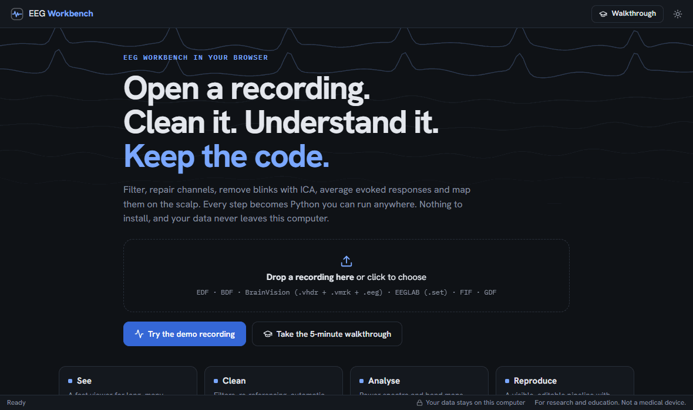
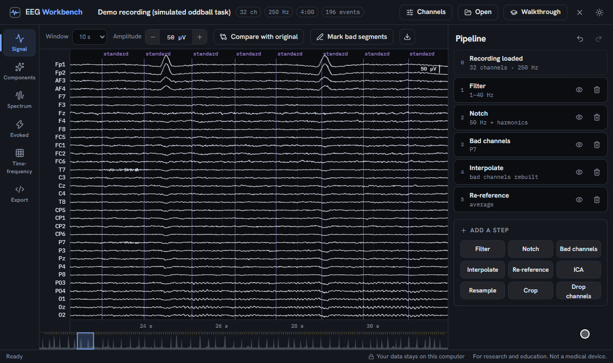
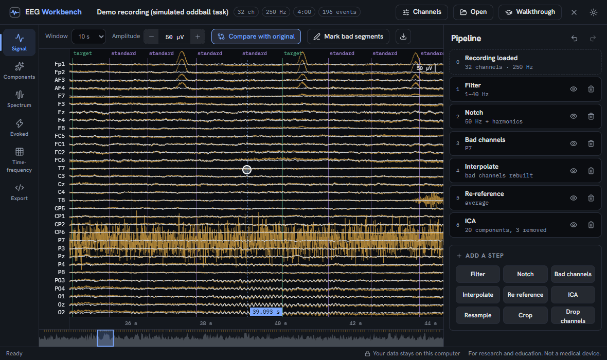
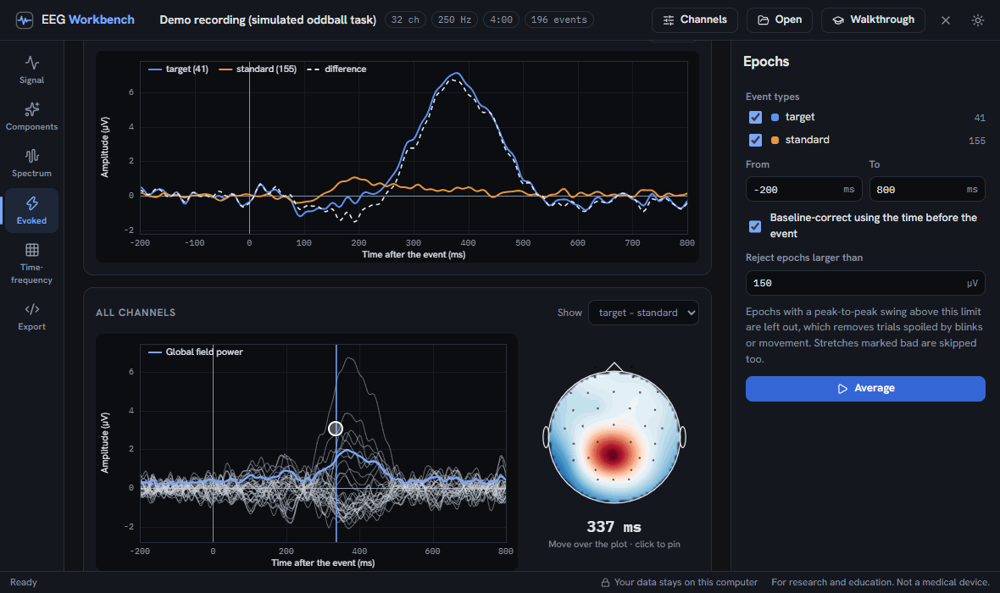

<div align="center">

# EEG Workbench

**EEG analysis that runs in your browser.**
Open a recording, clean it, analyse it, and export the Python code that reproduces every step.
Nothing to install. Your data never leaves your computer.

[](LICENSE)
[](https://mne.tools)
[](#how-it-works)



</div>

---

## Why

Looking inside an EEG recording usually starts with installing a scientific software stack. EEG Workbench removes that step. It is a single web page that gives students, researchers and clinicians doing research a complete, interactive EEG workflow, and it hands back real, readable code at the end so nothing is locked inside the tool.

## Features

### See the signal

- Smooth scrolling and zooming through long, many-channel recordings
- Events and annotations drawn on the timeline, with a whole-recording overview strip
- Click a channel name to mark it bad; drag across the signal to mark a bad stretch
- **Compare with original**: the untouched signal drawn underneath the cleaned one
- **Channel setup**: correct channel types and choose an electrode layout (standard 10-20 / 10-05, BioSemi, HydroCel GSN, EasyCap) when a cap uses its own naming
- Amplitude scale chosen automatically from the recording; save any view as an image

### Clean it

- Band-pass, high-pass and low-pass filters, and a mains notch filter with harmonics
- Re-referencing (average or chosen channels), resampling, cropping
- **Automatic bad-channel detection** (flat, noisy or disconnected) and interpolation from neighbours
- **ICA artifact removal** with a review screen: each component's scalp map, spectrum and share of the signal, with likely eye and muscle components labelled for you



### Analyse it

- **Evoked responses (ERPs)**: epoching with baseline correction and amplitude rejection, per-condition averages, difference waves, global field power, scalp maps at any moment, and peak measurements
- **Power spectrum**: per-channel spectra, band power (delta to gamma) as tables and scalp maps, peak alpha frequency, theta/beta and alpha/theta ratios, frontal alpha asymmetry
- **Time-frequency maps**: for the whole recording, or averaged across epochs relative to baseline



### Keep the code

- Every action is a step in a visible **pipeline** that you can edit, switch off, undo and redo
- Export the whole session as an **MNE-Python script** or a **Jupyter notebook**
- Export cleaned data as **FIF**, **EDF** or **BrainVision**, plus epochs, averages, figures (PNG) and tables (CSV)



### Learn as you go

- A built-in **demo recording** and a **guided walkthrough** that takes you from raw signal to a clean evoked response in about five minutes
- A plain-language explanation and practical tip on every processing step
- Light and dark themes, keyboard navigation

## Supported formats

| Format | Files |
|---|---|
| European Data Format | `.edf`, `.bdf` |
| BrainVision | `.vhdr` + `.vmrk` + `.eeg` (drop all three together) |
| EEGLAB | `.set` (+ `.fdt`) |
| MNE / Elekta | `.fif` |
| General Data Format | `.gdf` |

Channel types and standard 10-20/10-05 electrode positions are detected from channel names automatically, and can be changed in the Channels dialog.

## How it works

EEG Workbench is a static web page. Signal processing is done by [MNE-Python](https://mne.tools), [SciPy](https://scipy.org) and [scikit-learn](https://scikit-learn.org), running inside your browser through [Pyodide](https://pyodide.org) (Python compiled to WebAssembly) in a background thread.

- **Trustworthy results.** The numbers come from the same libraries researchers use in Python, not from a re-implementation.
- **Private by design.** There is no server to upload to. Recordings are read and processed on your own machine.
- **Reproducible.** The exported code calls the same functions with the same parameters.

The first visit downloads the analysis engine (about 40 MB). It is then stored by your browser, so later visits start in a few seconds.

## Privacy

Your recordings are never uploaded. EEG Workbench has no accounts, no analytics and no backend. The only network requests are for the app itself and the open-source Python packages it runs.

## Keyboard shortcuts

| Key | Action |
|---|---|
| `←` / `→` | Scroll half a window (`Shift` for a full window) |
| `↑` / `↓` or `+` / `-` | Larger / smaller traces |
| `Home` / `End` | Jump to the start / end |
| Mouse wheel | Scroll through time (`Ctrl` + wheel to zoom) |
| `Ctrl` + `Z` / `Ctrl` + `Y` | Undo / redo a pipeline change |

## Run it locally

Requires [Node.js](https://nodejs.org) 20.19 or newer.

```bash
git clone https://github.com/onshassanshahin-ops/eeg-workbench.git
cd eeg-workbench
npm install
npm run dev
```

Then open the address it prints (usually `http://localhost:5173`).

| Command | What it does |
|---|---|
| `npm run dev` | Start the development server |
| `npm run lint` | Static checks (the same ones CI runs) |
| `npm run build` | Type-check and build the static site into `dist/` |
| `npm test` | Run the engine's end-to-end tests under Pyodide (alias of `npm run test:engine`) |
| `npm run gifs` | Re-record the README animations (needs Google Chrome and a running dev server) |

Downloaded Python packages and the browser profile used for recording are kept in `.cache/`, which git ignores.

## Project layout

```
src/
  engine/
    python/engine.py   The analysis engine: session state, pipeline, analyses, code export
    worker.ts          Loads Pyodide and MNE in a Web Worker and runs engine commands
    client.ts          Promise-based client used by the interface
  components/          Viewer, charts, scalp maps and the six workspaces
  steps.ts             Definition of every pipeline step: parameters, explanation, validation
  store.ts             Application state (pipeline, undo/redo, results)
public/sw.js           Caches the engine's downloads so it only downloads once
scripts/
  engine-test.mjs      End-to-end engine tests
  record-gifs.mjs      Regenerates the README animations
docs/media/            The animations shown in this README
.github/               CI, deployment to GitHub Pages, issue and pull request templates
```

Community files in the repository root: [CONTRIBUTING.md](CONTRIBUTING.md), [CODE_OF_CONDUCT.md](CODE_OF_CONDUCT.md), [SECURITY.md](SECURITY.md), [CHANGELOG.md](CHANGELOG.md), [CITATION.cff](CITATION.cff), [LICENSE](LICENSE) and [NOTICE](NOTICE).

Adding a processing step means touching three small places: the step's definition in `steps.ts`, its implementation in `engine.py` (`_apply_step`), and its code template (`_step_code`). See [CONTRIBUTING.md](CONTRIBUTING.md).

## Roadmap

- Quantitative EEG report (printable summary of band power, ratios and asymmetry)
- Grand averages and batch processing across many files
- Statistics for condition comparisons, including permutation tests
- Connectivity measures
- Automatic detection of bad segments
- BIDS import and export, XDF and CSV import
- Offline use as an installable web app
- Translations

## Contributing

Contributions of every size are welcome: bug reports, explanations that could be clearer, translations, new processing steps and new analyses. Start with [CONTRIBUTING.md](CONTRIBUTING.md).

## Citing

If EEG Workbench helps your research or teaching, please cite it (see [CITATION.cff](CITATION.cff)) together with MNE-Python, which does the analysis:

> Gramfort A. et al. (2013). MEG and EEG data analysis with MNE-Python. *Frontiers in Neuroscience*, 7:267.

## Disclaimer

EEG Workbench is for research and education. It is not a medical device and must not be used for diagnosis or clinical decisions.

## Licence

[Apache License 2.0](LICENSE). Built on [MNE-Python](https://mne.tools), [SciPy](https://scipy.org), [scikit-learn](https://scikit-learn.org), [Picard](https://pierreablin.github.io/picard/) and [Pyodide](https://pyodide.org).
